# Documentación del desarrollo – TechStore INACAP

**Autor:** MauExpl01t
**Asignatura:** Desarrollo Web / Framework Django
**Evaluaciones:** Encargo Práctico CRUD Ventas (Fase 1) y Encargo Práctico API REST & Relaciones (Fase 2)

Este documento describe paso a paso cómo se construyó el sistema, qué decisiones se tomaron
y cómo se verificó que funcionara. Las instrucciones para ejecutarlo están en el [README](../README.md).

---

## Índice

1. [Objetivo](#1-objetivo)
2. [Tecnologías utilizadas](#2-tecnologías-utilizadas)
3. [Fase 1: proceso de desarrollo paso a paso](#3-fase-1-proceso-de-desarrollo-paso-a-paso)
4. [Fase 2: relaciones y API REST](#4-fase-2-relaciones-y-api-rest)
5. [Capturas de pantalla](#5-capturas-de-pantalla)
6. [Pruebas realizadas](#6-pruebas-realizadas)
7. [Decisiones de diseño](#7-decisiones-de-diseño)

---

## 1. Objetivo

La empresa **TechStore INACAP** necesita un sistema web interno para administrar su catálogo
de productos electrónicos (consolas, computadores, componentes y periféricos).
Cualquier persona puede ver el catálogo, pero solo los usuarios que inician sesión pueden
**crear, modificar y eliminar** productos.

El proyecto se desarrolló en dos fases:

- **Fase 1 (Evaluación 2):** CRUD web de productos con autenticación. Quedó marcada en Git con la
  etiqueta `evaluacion-2`.
- **Fase 2 (Evaluación 3):** los productos se clasifican con una relación hacia el modelo `Categoria`,
  las categorías se administran desde la web y se agrega una **API REST** protegida con tokens, para
  intercambiar información con aplicaciones móviles y plataformas externas.

---

## 2. Tecnologías utilizadas

| Tecnología | Uso |
|------------|-----|
| Python 3 | Lenguaje de programación |
| Django 5.2 LTS | Framework web (modelos, vistas, plantillas, autenticación, admin) |
| Django REST Framework 3.18 | Construcción de la API REST: serializadores, viewsets, router y autenticación por token (Fase 2) |
| MySQL 8.0 | Motor de base de datos |
| mysqlclient | Conector que permite a Django comunicarse con MySQL |
| python-dotenv | Lee las credenciales de MySQL desde el archivo `.env` |
| Pillow | Librería de imágenes que usa `ImageField` para validar las fotos de los productos (Fase 2) |
| MySQL Workbench | Interfaz gráfica para administrar y revisar la base de datos |
| Bootstrap 5 + Bootstrap Icons | Diseño de la interfaz (cargados por CDN) |
| Git | Control de versiones |

---

## 3. Fase 1: proceso de desarrollo paso a paso

> Esta sección describe cómo se construyó la primera versión. Los cambios de la Fase 2
> (por ejemplo, la categoría como relación en lugar de texto) están en la sección 4.

### Paso 1 – Entorno virtual e instalación de Django

Se creó un entorno virtual para aislar las dependencias del proyecto y se instaló Django:

```bash
python -m venv venv
.\venv\Scripts\Activate.ps1
pip install "django>=5.2,<5.3" mysqlclient python-dotenv
pip freeze > requirements.txt
```

- Se usa **Django 5.2 LTS** porque es compatible con MySQL 8.0 (Django 6 exige MySQL 8.4 o superior)
  y tiene soporte extendido hasta abril de 2028.
- `mysqlclient` es el conector de MySQL que recomienda la documentación de Django.
- `requirements.txt` guarda las versiones exactas, para que cualquiera pueda reproducir el entorno
  con `pip install -r requirements.txt`.

### Paso 2 – Creación del proyecto y la app

```bash
django-admin startproject techstore_project .
python manage.py startapp catalogo
```

- `techstore_project` contiene la configuración general (`settings.py`, `urls.py`).
- `catalogo` es la app con la lógica del negocio (modelo, vistas, formularios y plantillas).

### Paso 3 – Configuración (`techstore_project/settings.py`)

- Se registró la app en `INSTALLED_APPS` agregando `'catalogo'`.
- Idioma y zona horaria de Chile: `LANGUAGE_CODE = 'es-cl'` y `TIME_ZONE = 'America/Santiago'`.
  Así los mensajes de validación de Django aparecen en español.
- Configuración de autenticación:

```python
LOGIN_URL = 'login'                        # a dónde se envía al usuario sin sesión
LOGIN_REDIRECT_URL = 'catalogo:lista'      # a dónde va después de iniciar sesión
LOGOUT_REDIRECT_URL = 'catalogo:lista'     # a dónde va después de cerrar sesión
```

- Base de datos MySQL. Primero se creó la base y un usuario propio para el proyecto con el script
  `mysql/crear_base_datos.sql`, ejecutado como `root` (por terminal o desde MySQL Workbench):

```sql
CREATE DATABASE IF NOT EXISTS techstore_db CHARACTER SET utf8mb4 COLLATE utf8mb4_unicode_ci;
CREATE USER IF NOT EXISTS 'techstore_user'@'localhost' IDENTIFIED BY '...';
GRANT ALL PRIVILEGES ON techstore_db.* TO 'techstore_user'@'localhost';
```

  Luego se configuró la conexión en `settings.py`. Las credenciales no se escriben en el código:
  se leen del archivo `.env` (que no se sube a Git) con `python-dotenv`:

```python
DATABASES = {
    'default': {
        'ENGINE': 'django.db.backends.mysql',
        'NAME': os.getenv('DB_NAME', 'techstore_db'),
        'USER': os.getenv('DB_USER', 'techstore_user'),
        'PASSWORD': os.getenv('DB_PASSWORD', ''),
        'HOST': os.getenv('DB_HOST', 'localhost'),
        'PORT': os.getenv('DB_PORT', '3306'),
        'OPTIONS': {'charset': 'utf8mb4'},
    }
}
```

  - Se usa un usuario propio (`techstore_user`) y no `root`: solo tiene permisos sobre `techstore_db`.
  - `utf8mb4` permite guardar cualquier carácter (tildes, ñ, símbolos).

### Paso 4 – Modelo `Producto` (`catalogo/models.py`)

Se definió el modelo con los campos que pide el encargo, eligiendo el tipo de dato adecuado para cada uno:

| Campo | Tipo de Django | Por qué |
|-------|----------------|---------|
| `nombre` | `CharField(max_length=120)` | Texto corto |
| `categoria` | `CharField` con `choices` | Solo permite categorías válidas y genera una lista desplegable |
| `precio` | `DecimalField(max_digits=10, decimal_places=0)` | Valor monetario exacto (el peso chileno no usa decimales) |
| `stock` | `IntegerField` con `MinValueValidator(0)` | Número entero, no puede ser negativo |
| `descripcion` | `TextField` | Texto largo para la ficha técnica |
| `estado` | `BooleanField` con choices | `True` = Disponible, `False` = Agotado |
| `creado` / `actualizado` | `DateTimeField` | Fechas automáticas de auditoría |

Además se agregó:

- **Regla de negocio** en `save()`: si el stock es 0, el producto queda automáticamente como agotado.
- `get_absolute_url()`: devuelve la URL del detalle, para redirigir después de crear o editar.
- La propiedad `icono`: el ícono que se muestra en la tarjeta según la categoría.

### Paso 5 – Migraciones

```bash
python manage.py makemigrations
python manage.py migrate
```

- `makemigrations` generó `catalogo/migrations/0001_initial.py` a partir del modelo.
- `migrate` creó las tablas en la base `techstore_db` de MySQL (las de Django y la tabla
  `catalogo_producto`). Se pueden ver en MySQL Workbench, en el panel **Schemas**.

### Paso 6 – Panel administrativo (`catalogo/admin.py`)

Se registró el modelo en el admin de Django con columnas, filtros, búsqueda y edición rápida
de precio y stock (`list_display`, `list_filter`, `search_fields`, `list_editable`).

### Paso 7 – Formularios (`catalogo/forms.py`)

Se creó `ProductoForm`, un **`ModelForm`**: Django genera los campos a partir del modelo, y con
`widgets` se personaliza cómo se dibuja cada uno en HTML:

| Campo | Widget | Clase CSS |
|-------|--------|-----------|
| nombre | `TextInput` | `form-control` + placeholder |
| categoria | `Select` (lista desplegable) | `form-select` |
| precio, stock | `NumberInput` | `form-control` + `min` |
| descripcion | `Textarea` | `form-control` + `rows=5` |
| estado | `RadioSelect` (selección) | `form-check-input` |

También se agregó:

- `clean_nombre()`: validación personalizada (mínimo 3 caracteres).
- `_post_clean()`: agrega la clase `is-invalid` a los campos con error para mostrarlos en rojo.
- `LoginForm`: hereda de `AuthenticationForm` (de `django.contrib.auth`) solo para darle clases CSS
  a los campos de usuario y contraseña.

### Paso 8 – Vistas (`catalogo/views.py`)

Se usaron vistas basadas en funciones:

| Vista | Tipo | Qué hace |
|-------|------|----------|
| `lista_productos` | Pública | Lista los productos; permite buscar por texto y filtrar por categoría |
| `detalle_producto` | Pública | Muestra la ficha técnica (`get_object_or_404`) |
| `crear_producto` | **Privada** | GET muestra el formulario vacío; POST valida y guarda |
| `editar_producto` | **Privada** | Igual que crear, pero con `instance=producto` |
| `eliminar_producto` | **Privada** | GET muestra la confirmación; **solo POST elimina** |

Las vistas privadas usan el decorador **`@login_required`**. Si un usuario sin sesión intenta entrar,
Django lo redirige a `/login/?next=<url>` y, después de iniciar sesión, lo devuelve a la página que pidió.

Después de crear, editar o eliminar, se muestra un mensaje de confirmación con el framework de
mensajes de Django (`messages.success`).

### Paso 9 – URLs

`catalogo/urls.py` (con `app_name = 'catalogo'` para usar nombres como `catalogo:detalle`):

```python
path('', views.lista_productos, name='lista'),
path('producto/<int:pk>/', views.detalle_producto, name='detalle'),
path('producto/nuevo/', views.crear_producto, name='crear'),
path('producto/<int:pk>/editar/', views.editar_producto, name='editar'),
path('producto/<int:pk>/eliminar/', views.eliminar_producto, name='eliminar'),
```

`techstore_project/urls.py` agrega el admin, el login y el logout de `django.contrib.auth`:

```python
path('login/', auth_views.LoginView.as_view(
    template_name='registration/login.html',
    authentication_form=LoginForm,
    redirect_authenticated_user=True,
), name='login'),
path('logout/', auth_views.LogoutView.as_view(), name='logout'),
```

### Paso 10 – Plantillas (`catalogo/templates/`)

- **`base.html`** es el layout principal: contiene el `<head>`, la barra de navegación, los mensajes
  y el pie de página. Define el bloque ``.
- Todas las demás plantillas empiezan con `` y solo rellenan su contenido
  (**herencia de plantillas**).
- **Barra de navegación dinámica:** usa ``:
  - Visitante → muestra "Visitante" y el botón *Iniciar sesión*.
  - Usuario autenticado → muestra *Nuevo producto*, *Panel admin* (solo si es staff),
    "Hola, *usuario*" y *Cerrar sesión*.
- El botón *Cerrar sesión* es un formulario **POST** con ``, porque desde
  Django 5 el logout ya no acepta GET.
- `lista.html` presenta los productos en **tarjetas (cards)** dentro de una grilla de Bootstrap;
  cada tarjeta tiene un ícono según la categoría (consola, notebook, PC, etc.).

### Paso 11 – Estilos y formato de precios

- `catalogo/static/catalogo/css/estilos.css`: paleta sobria en grises, sombra suave al pasar el mouse
  sobre las tarjetas y estilos de foco en los formularios.
- `catalogo/templatetags/formato.py`: filtro propio `|clp` que muestra los precios
  con formato chileno (`549990` → `$549.990`).

### Paso 12 – Datos de ejemplo y superusuario

```bash
python manage.py loaddata productos
python manage.py createsuperuser
```

- `catalogo/fixtures/productos.json` contiene 11 productos reales de ejemplo
  (PS5, Switch OLED, Xbox Series X, notebooks, RTX 4070, etc.).
- Superusuario de prueba: **`admin` / `admin`**.

### Paso 13 – Pruebas automatizadas y control de versiones

```bash
python manage.py test catalogo
git init
git add .
git commit -m "Proyecto TechStore INACAP: CRUD de productos con Django"
```

---

## 4. Fase 2: relaciones y API REST

### Paso 1 – Modelo `Categoria` y relación con `Producto` (`catalogo/models.py`)

```python
class Categoria(models.Model):
    nombre = models.CharField('nombre', max_length=80, unique=True)
    descripcion = models.TextField('descripción', blank=True)


class Producto(models.Model):
    ...
    categoria = models.ForeignKey(
        Categoria,
        verbose_name='categoría',
        on_delete=models.PROTECT,
        related_name='productos',
    )
```

- `Categoria.descripcion` es **opcional** gracias a `blank=True`.
- `ForeignKey` crea una relación **muchos a uno**: muchos productos pertenecen a una categoría.
  En MySQL es la columna `categoria_id` de `catalogo_producto`, con una restricción de clave foránea
  hacia `catalogo_categoria`.
- `on_delete=PROTECT`: no se puede borrar una categoría que todavía tiene productos.
- `related_name='productos'`: desde una categoría se obtienen sus productos con `categoria.productos.all()`.

### Paso 2 – Migración con conversión de datos

Los 11 productos existentes tenían la categoría como texto (`'CONSOLAS'`). Para no perder datos,
la migración `0002_categoria_y_relacion.py` se escribió a mano y hace el cambio en cinco pasos:

1. Crea la tabla `catalogo_categoria`.
2. Renombra temporalmente el campo de texto a `categoria_texto`.
3. Agrega la `ForeignKey` `categoria`, vacía por ahora (`null=True`).
4. Con `RunPython` crea las categorías que estaban en uso y enlaza cada producto con la suya.
5. Elimina `categoria_texto` y deja la relación como obligatoria.

```bash
python manage.py migrate
```

Resultado: 5 categorías y los 11 productos enlazados, sin inconsistencias
(`python manage.py makemigrations --check` responde "No changes detected").

### Paso 3 – Formularios (`catalogo/forms.py`)

- **`CategoriaForm`**: `ModelForm` con `nombre` y `descripcion`, widgets con clases de Bootstrap,
  validación de mínimo 3 caracteres y mensaje propio si el nombre ya existe.
- **`ProductoForm`**: como `categoria` ahora es una `ForeignKey`, Django genera un `ModelChoiceField`.
  El `<select>` ya no tiene una lista fija: sus opciones se **consultan a la base de datos** cada vez
  que se muestra el formulario.

```python
def __init__(self, *args, **kwargs):
    super().__init__(*args, **kwargs)
    self.fields['categoria'].queryset = Categoria.objects.order_by('nombre')
    self.fields['categoria'].empty_label = 'Selecciona una categoría'
```

Si se crea una categoría nueva, aparece de inmediato en el desplegable del formulario de productos.

### Paso 4 – Vistas web de categorías (`catalogo/views.py`)

| Vista | URL | Acceso | Qué hace |
|-------|-----|--------|----------|
| `lista_categorias` | `/categorias/` | Pública | Tabla de categorías con la cantidad de productos de cada una |
| `crear_categoria` | `/categorias/nueva/` | **`@login_required`** | Formulario `CategoriaForm` |
| `editar_categoria` | `/categorias/<id>/editar/` | **`@login_required`** | Mismo formulario con `instance=categoria` |
| `eliminar_categoria` | `/categorias/<id>/eliminar/` | **`@login_required`** | GET muestra la confirmación; POST elimina |

Si la categoría tiene productos, `on_delete=PROTECT` hace que la base de datos rechace el borrado
(`ProtectedError`); la vista captura ese error y muestra un aviso en vez de fallar.

- La cantidad de productos se calcula en la base de datos con `annotate(total_productos=Count('productos'))`.
- En el catálogo se usa `select_related('categoria')`, que trae cada producto junto a su categoría en
  una sola consulta (JOIN) en vez de una consulta por tarjeta.
- Se agregó el enlace **Categorías** a la barra de navegación y el modelo al panel `/admin/`.

### Paso 5 – Django REST Framework

```bash
pip install djangorestframework
pip freeze > requirements.txt
```

En `settings.py`:

```python
INSTALLED_APPS = [
    ...
    'rest_framework',             # Django REST Framework
    'rest_framework.authtoken',   # autenticación por token
    'catalogo',
]

REST_FRAMEWORK = {
    'DEFAULT_AUTHENTICATION_CLASSES': [
        'rest_framework.authentication.TokenAuthentication',
    ],
    'DEFAULT_PERMISSION_CLASSES': [
        'rest_framework.permissions.IsAuthenticatedOrReadOnly',
    ],
}
```

`python manage.py migrate` creó además la tabla `authtoken_token`, donde se guarda el token de cada usuario.

### Paso 6 – Serializadores (`catalogo/serializers.py`)

Un serializador convierte objetos del modelo a JSON (para responder) y valida el JSON recibido
(para crear o editar). Es el equivalente del `ModelForm`, pero para la API.

```python
class CategoriaSerializer(serializers.ModelSerializer):
    class Meta:
        model = Categoria
        fields = ['id', 'nombre', 'descripcion']


class ProductoSerializer(serializers.ModelSerializer):
    categoria_detalle = CategoriaSerializer(source='categoria', read_only=True)

    class Meta:
        model = Producto
        fields = ['id', 'nombre', 'categoria', 'categoria_detalle', 'precio', 'stock',
                  'descripcion', 'estado', 'creado', 'actualizado']
        read_only_fields = ['creado', 'actualizado']
```

- `categoria` es el **id** de la categoría: se usa al leer y al escribir.
- `categoria_detalle` muestra los datos completos de la categoría (solo lectura), reutilizando `CategoriaSerializer`.
- Las validaciones del modelo (precio y stock ≥ 0, categoría existente) se aplican también en la API.

### Paso 7 – Vistas y rutas de la API (`catalogo/api_views.py`, `catalogo/api_urls.py`)

```python
class ProductoViewSet(viewsets.ModelViewSet):
    queryset = Producto.objects.select_related('categoria')
    serializer_class = ProductoSerializer
    authentication_classes = [TokenAuthentication]
    permission_classes = [IsAuthenticatedOrReadOnly]
```

Un `ModelViewSet` implementa las cinco operaciones (listar, detallar, crear, modificar y eliminar).
El `DefaultRouter` genera las rutas:

```python
router = DefaultRouter()
router.register('productos', api_views.ProductoViewSet, basename='producto')
router.register('categorias', api_views.CategoriaViewSet, basename='categoria')

urlpatterns = [
    path('token/', obtain_auth_token, name='api-token'),
    path('', include(router.urls)),
]
```

| Método | URL | Acción | Acceso |
|--------|-----|--------|--------|
| GET | `/api/productos/` | Listar | Público |
| GET | `/api/productos/<id>/` | Detalle | Público |
| POST | `/api/productos/` | Crear | Token |
| PUT | `/api/productos/<id>/` | Edición total | Token |
| PATCH | `/api/productos/<id>/` | Edición parcial | Token |
| DELETE | `/api/productos/<id>/` | Eliminar | Token |

### Paso 8 – Autenticación por token

1. El cliente envía usuario y contraseña a `POST /api/token/` (vista `obtain_auth_token` de DRF)
   y recibe su token.
2. En cada petición privada envía la cabecera `Authorization: Token <clave>`.
3. `TokenAuthentication` busca esa clave en la tabla `authtoken_token` e identifica al usuario.
4. El permiso `IsAuthenticatedOrReadOnly` deja pasar los métodos de lectura (GET) a cualquiera y exige
   un usuario autenticado para POST, PUT, PATCH y DELETE. Sin token válido la respuesta es **401**.

Los ejemplos de consumo con `curl`, PowerShell y Postman están en el [README](../README.md#api-rest).
También se incluye una colección de Postman en `docs/TechStore_API.postman_collection.json`.

### Paso 9 – Foto de cada producto (adicional)

```bash
pip install pillow
```

```python
# models.py
imagen = models.ImageField('imagen', upload_to='productos/', blank=True)

# settings.py
MEDIA_URL = 'media/'
MEDIA_ROOT = BASE_DIR / 'media'

# techstore_project/urls.py  (solo en desarrollo, con DEBUG=True)
urlpatterns += static(settings.MEDIA_URL, document_root=settings.MEDIA_ROOT)
```

- `ImageField` guarda el **archivo** en `media/productos/` y en la base de datos solo su **ruta**.
  Pillow comprueba que el archivo subido sea realmente una imagen.
- Migración `0003_producto_imagen.py` (generada con `makemigrations`).
- En `ProductoForm` se agregó el campo con el widget `ClearableFileInput`, un límite de 2 MB
  (`clean_imagen`) y, en la plantilla, `enctype="multipart/form-data"`; las vistas reciben el archivo
  con `request.FILES`.
- Las tarjetas y el detalle muestran la foto; si el producto no tiene, aparece el ícono de su categoría.
- En la API, `imagen` entrega la dirección de la foto y es de solo lectura.
- Las 11 fotos de ejemplo provienen de Wikimedia Commons con licencias libres; el detalle de autores
  está en [CREDITOS_IMAGENES.md](CREDITOS_IMAGENES.md).

---

## 5. Capturas de pantalla

### Catálogo como visitante (sin sesión)
Barra de navegación con "Visitante" e "Iniciar sesión". No aparecen botones de edición.

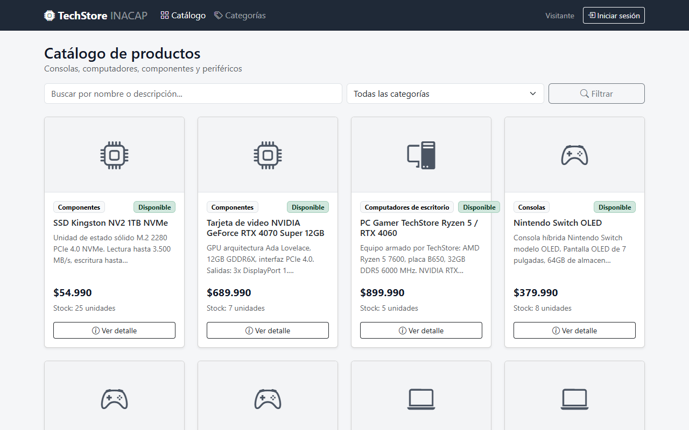

### Detalle técnico de un producto

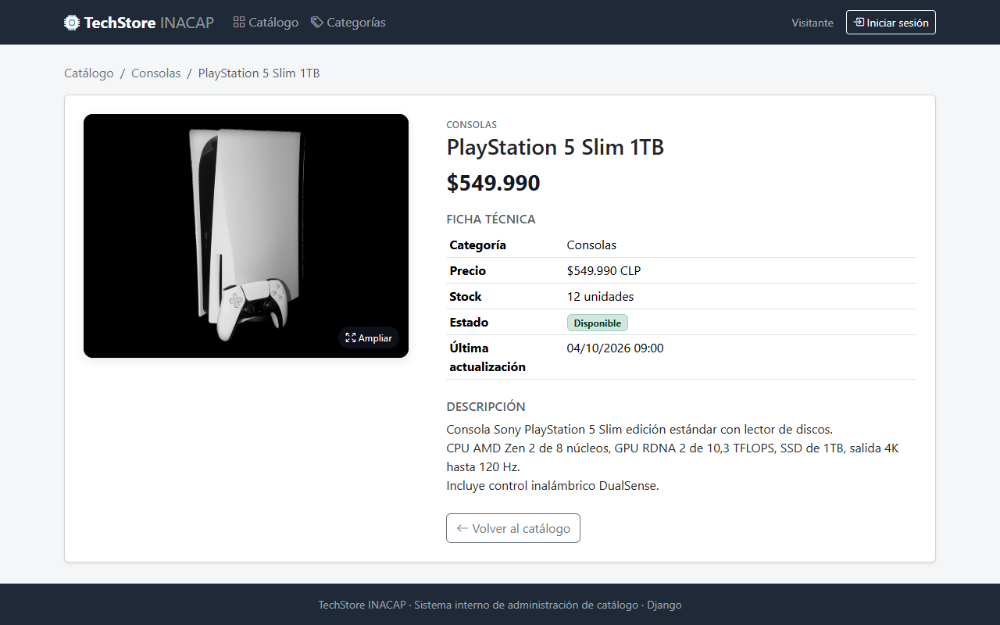

### Protección con `@login_required`
Al intentar entrar a `/producto/nuevo/` sin sesión, el sistema redirige al login.

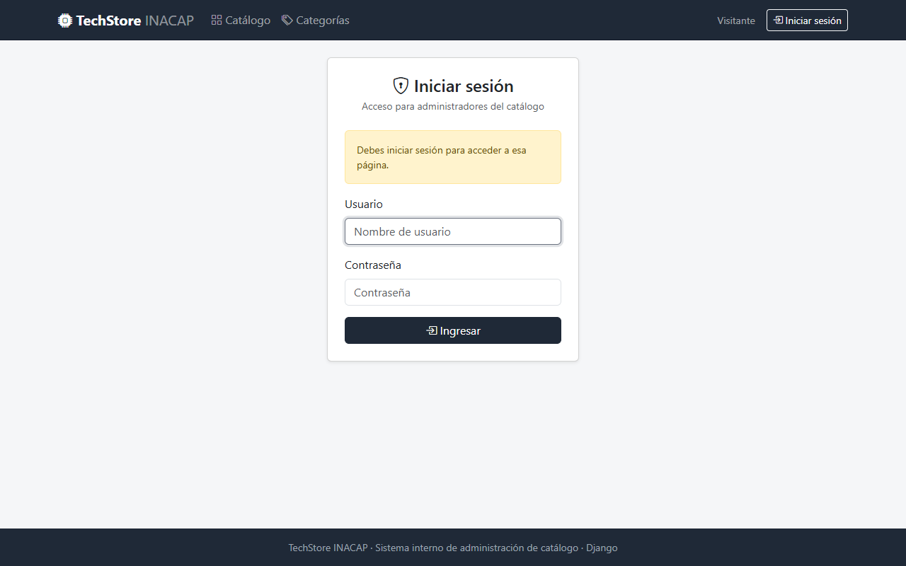

### Catálogo con sesión iniciada
La barra cambia: aparecen "Categorías", "Nuevo producto", "Panel admin", el saludo y "Cerrar sesión".
Cada tarjeta muestra la foto del producto y los botones Editar y Eliminar.

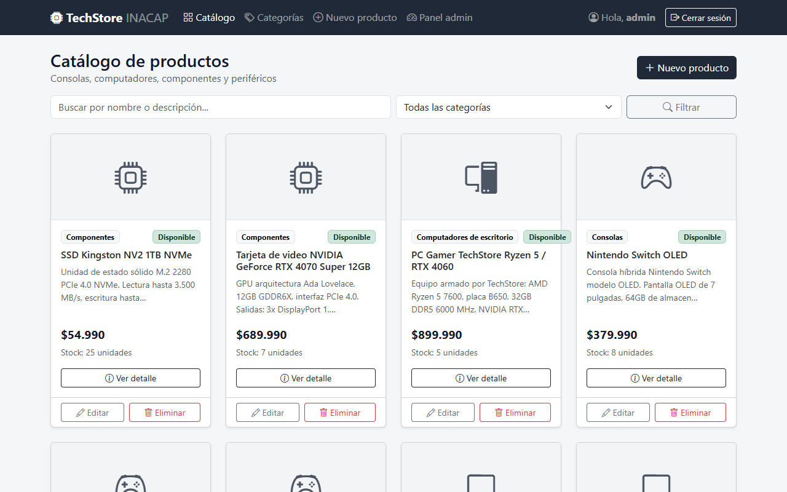

Catálogo completo con los 11 productos y sus fotos:

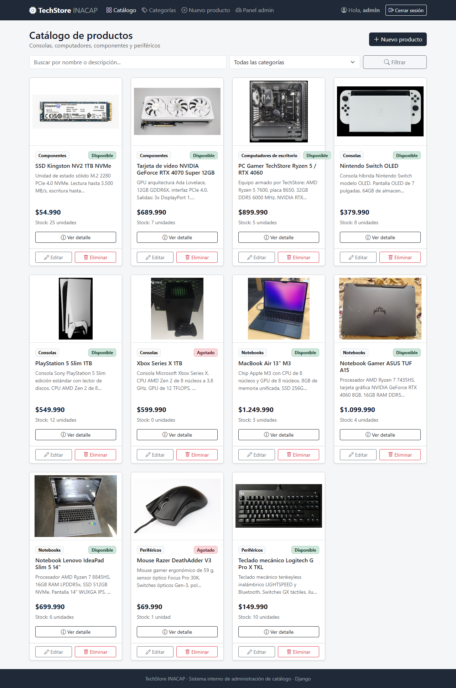

### Formulario de creación (ModelForm con widgets)

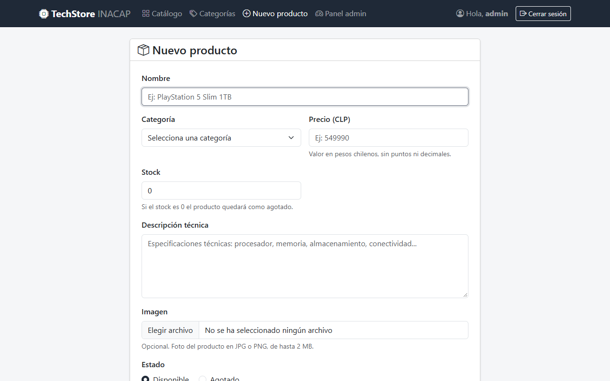

### Validación del formulario
Al enviarlo vacío, los campos obligatorios se marcan en rojo con el mensaje de error.

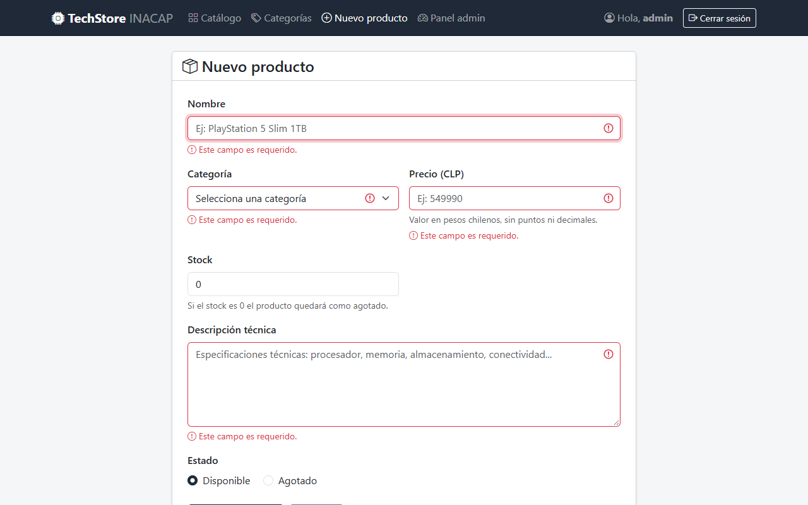

### Formulario de edición

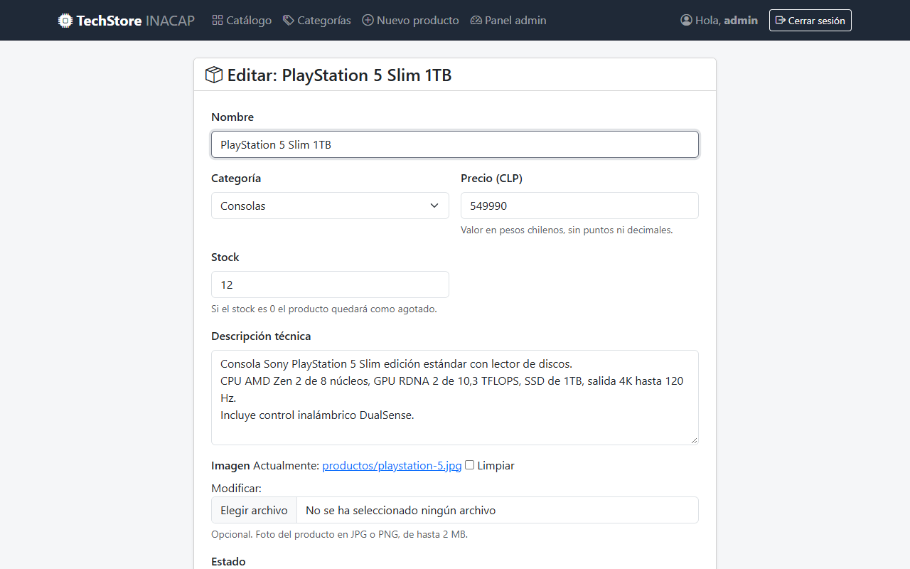

### Confirmación de eliminación

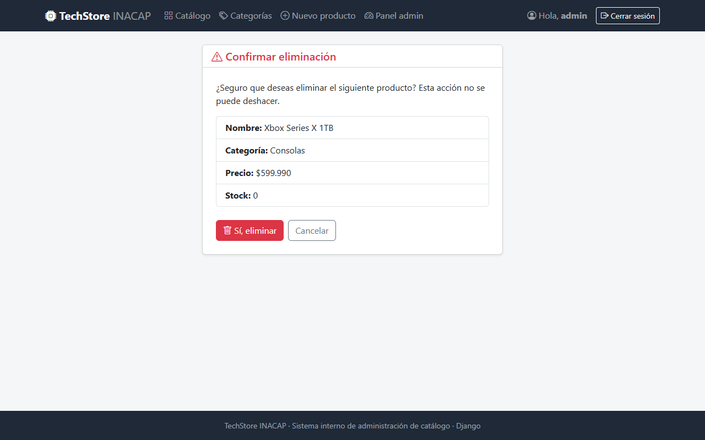

### Panel administrativo de Django

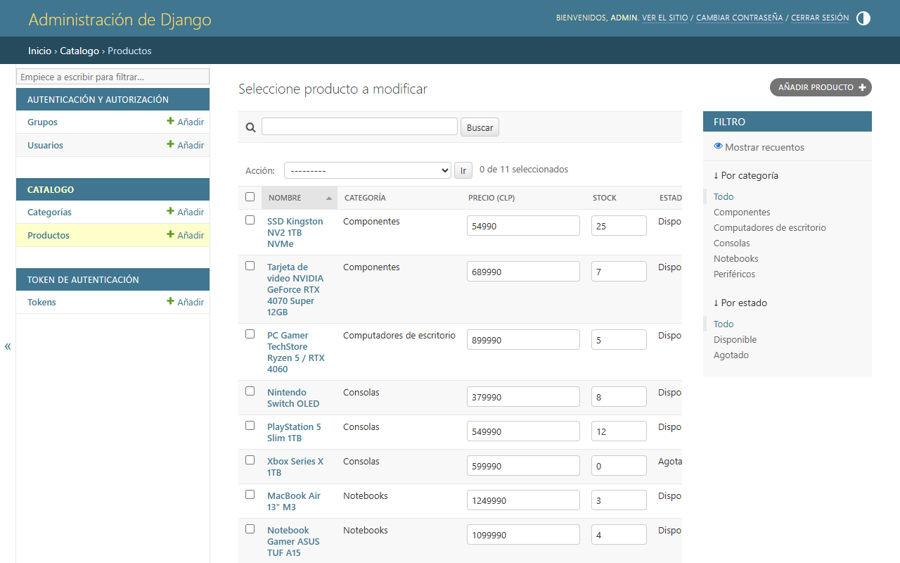

### Vista en celular (diseño responsivo)

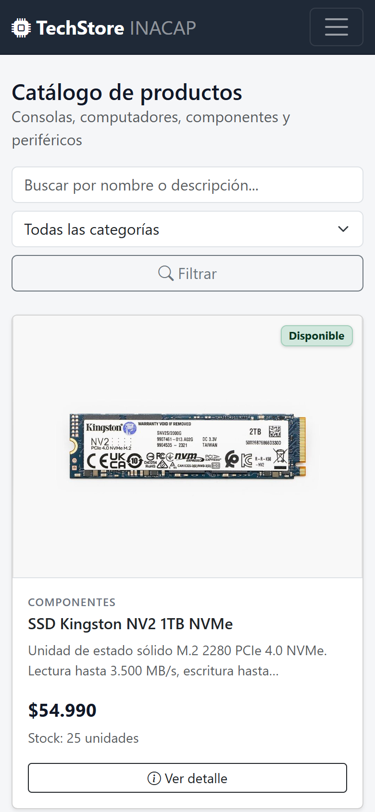

### Fase 2 – Listado de categorías
Como visitante solo se puede consultar. Con sesión iniciada aparecen "Nueva categoría" y "Editar".

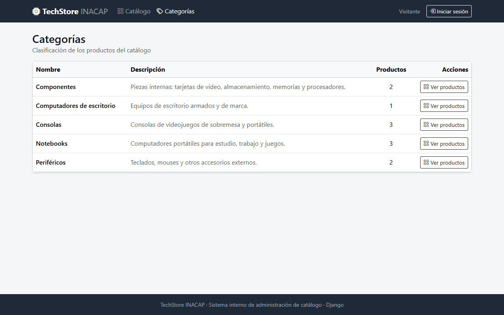

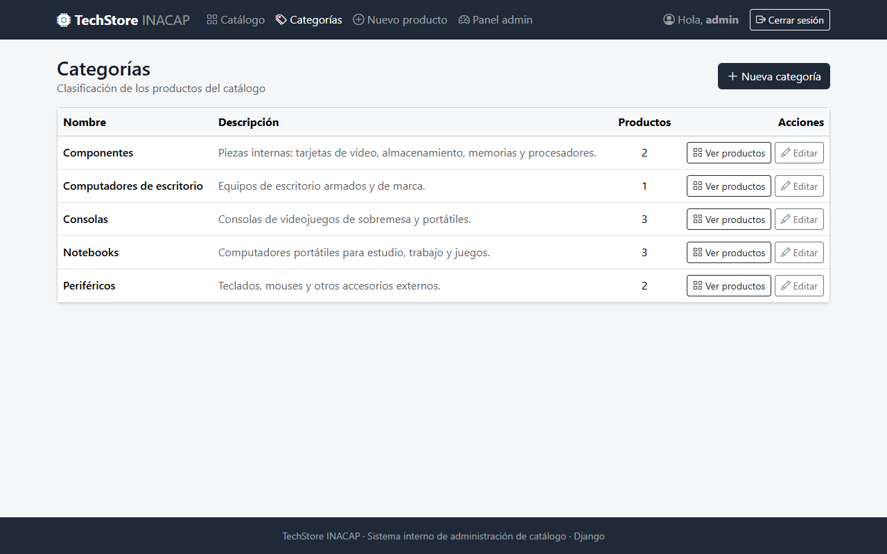

### Fase 2 – Formulario de categoría (ModelForm)

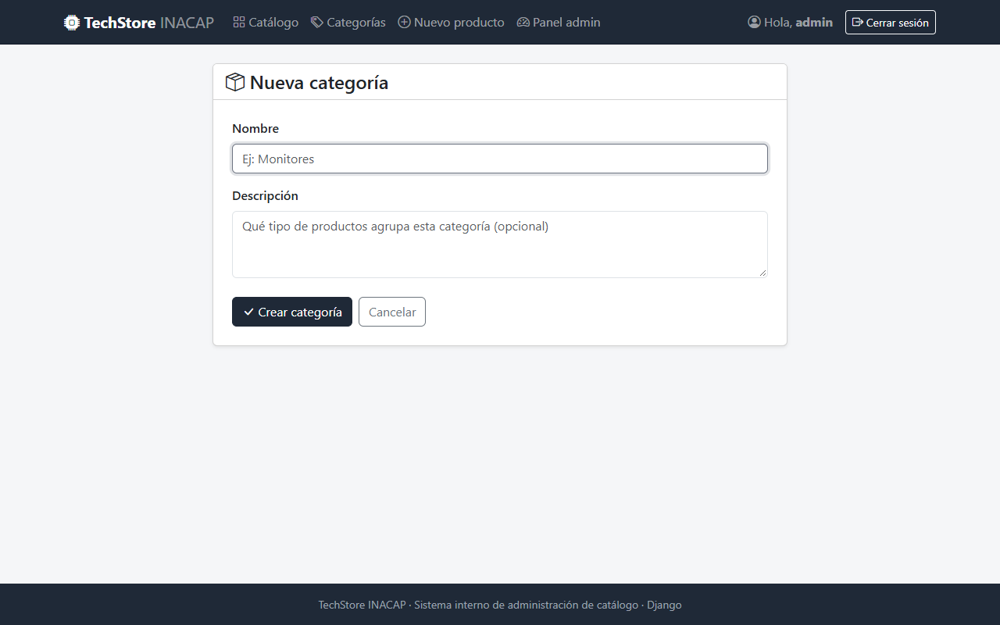

### Fase 2 – Confirmación de eliminación de categoría
Avisa que una categoría con productos no se podrá eliminar.

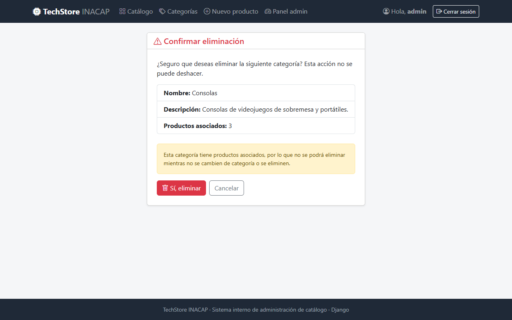

### Fase 2 – API REST
`GET /api/productos/1/` en la interfaz navegable de Django REST Framework: respuesta en JSON con la
categoría relacionada y los métodos permitidos.

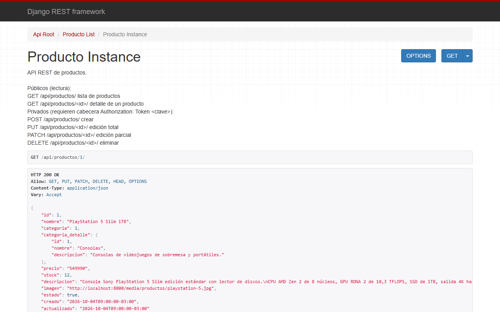

---

## 6. Pruebas realizadas

### Pruebas automatizadas (`catalogo/tests.py`)

```bash
python manage.py test catalogo
```

Resultado: **35 pruebas, todas correctas (OK)**. Django las ejecuta en una base de datos temporal
(`test_techstore_db`), por lo que no modifican los datos reales.

| Grupo | Pruebas | Qué verifica |
|-------|---------|--------------|
| `ModelosTests` | 2 | Stock 0 deja el producto agotado; la relación funciona en ambos sentidos (`producto.categoria` y `categoria.productos`) |
| `VistasProductoTests` | 9 | Catálogo y detalle públicos, filtro por categoría, redirección al login, el `<select>` muestra las categorías de la base, crear, editar, eliminar y navbar |
| `ImagenProductoTests` | 4 | Subir una foto y verla en la tarjeta, ícono cuando no hay foto, rechazo de archivos que no son imagen, y la API entrega la dirección de la foto |
| `VistasCategoriaTests` | 7 | Listado público; crear, editar y eliminar exigen login; crear, editar, eliminar, protección de categorías con productos y rechazo de nombres duplicados |
| `ApiProductosTests` | 9 | GET público (lista y detalle); POST, PUT, PATCH y DELETE responden 401 sin token o con token inválido; con token responden 201, 200, 200 y 204; datos inválidos responden 400 |
| `ApiTokenTests` | 2 | `/api/token/` entrega el token con credenciales correctas y lo niega con incorrectas |
| `ApiCategoriasTests` | 2 | Listado público; no se elimina una categoría con productos (409) |

### Pruebas de la API con `curl`

Se ejecutaron contra el servidor en funcionamiento todos los ejemplos del README:

| Petición | Resultado |
|----------|-----------|
| `GET /api/productos/` y `GET /api/productos/2/` sin token | 200 |
| `POST /api/productos/` sin token | 401 – "Las credenciales de autenticación no se proveyeron." |
| `POST /api/token/` con `admin` / `admin` | 200 – token de 40 caracteres |
| `POST /api/token/` con contraseña incorrecta | 400 |
| `POST /api/productos/` con token | 201 |
| `PUT /api/productos/<id>/` con token | 200 |
| `PATCH /api/productos/<id>/` con `{"stock": 0}` y token | 200 – el producto queda con `"estado": false` |
| `DELETE /api/productos/<id>/` con token | 204 |
| `DELETE /api/productos/1/` con token inválido | 401 – "Token inválido." |

### Pruebas manuales en el navegador

- [x] El catálogo y el detalle se ven sin iniciar sesión.
- [x] Al entrar a una vista privada sin sesión se redirige al login.
- [x] El login con `admin` / `admin` funciona y vuelve a la página solicitada.
- [x] La barra de navegación cambia según el estado del usuario.
- [x] El formulario muestra errores en español y marca los campos en rojo.
- [x] Los productos guardados se ven tanto en el catálogo como en `/admin/`.
- [x] Cerrar sesión devuelve al catálogo como visitante.
- [x] El diseño se adapta a la pantalla del celular.
- [x] La página de categorías muestra las 5 categorías con su cantidad de productos.
- [x] El desplegable de categoría del formulario de productos muestra las categorías de la base de datos.
- [x] `/api/productos/1/` responde en JSON con la categoría relacionada.

---

## 7. Decisiones de diseño

- **Vistas basadas en funciones** en lugar de clases: el flujo GET/POST queda explícito
  y se ve claramente dónde se aplica `@login_required`.
- **La eliminación solo ocurre con POST:** un enlace (GET) nunca borra datos; siempre pasa por
  la página de confirmación y el formulario lleva token CSRF.
- **`DecimalField` para el precio:** evita los errores de redondeo de `FloatField` en valores monetarios.
- **Categoría como `ForeignKey` (Fase 2):** las categorías dejan de ser una lista fija en el código y pasan a
  ser datos administrables desde la web; se pueden agregar sin modificar el programa.
- **`on_delete=PROTECT`:** borrar una categoría no puede eliminar ni dejar huérfanos a sus productos.
- **`ModelViewSet` + `DefaultRouter` para la API:** cubren el ciclo completo (listar, detallar, crear,
  modificar y eliminar) con poco código y rutas REST estándar.
- **Solo `TokenAuthentication` en la API:** las operaciones de escritura exigen siempre el token en la
  cabecera, como pide el encargo; la sesión del sitio web no sirve para escribir por la API.
- **`IsAuthenticatedOrReadOnly`:** una sola regla expresa "leer es público, escribir requiere token".
- **API dentro de la app `catalogo`:** en archivos separados (`serializers.py`, `api_views.py`,
  `api_urls.py`) para no mezclarla con las vistas HTML.
- **Una sola plantilla (`formulario.html`) para crear y editar:** sirve para productos y categorías;
  la vista le pasa el título, el texto del botón y a dónde volver al cancelar.
- **Foto opcional con ícono de respaldo:** el campo `imagen` no es obligatorio; un producto sin foto
  muestra el ícono de su categoría, así el catálogo nunca queda con un espacio vacío.
- **La foto se sube solo por la web, no por la API:** la API trabaja con JSON; `imagen` es de solo lectura
  para que crear y editar productos por la API siga siendo un JSON simple.

